<h1 align="center">
  
</h1>

<p align="center">
  <a href="https://www.npmjs.com/package/@acrasie/forgix"></a>
  <a href="./LICENSE"></a>
  <a href="#requirements">= 26" /></a>
</p>

<p align="center">
  Turn a software objective into an approved, implemented, and verified change.
</p>

Forgix is a workflow plugin and CLI for **Codex**, **Claude Code**, and **Antigravity**.
It helps your coding agent clarify what to build, prepare a plan, and verify the result.

- **Plan with context.** Inspect the repository and resolve missing decisions before editing.
- **Stay in control.** Review and approve the plan before the interactive task implements it.
- **Get evidence.** Finish with fresh review and command-backed verification.

## Requirements

**Node.js 26 or newer**, **Git**, and a supported agent with plugin support on
**Linux or macOS**. Windows is unsupported. Bun is only needed for repository development.

## Install

Choose your coding agent:

### Codex

```sh
codex plugin marketplace add Acrazie/forgix
codex plugin add forgix@acrazie
```

Start a new Codex session after installation.

### Claude Code

Run inside Claude Code:

```text
/plugin marketplace add Acrazie/forgix
/plugin install forgix@acrazie
```

### Antigravity CLI

```sh
agy plugin install https://github.com/Acrazie/forgix
```

For Antigravity App/for IDEs, run `/plugin`. Start a new host session after installation or update.

See [Getting Started](./docs/getting-started.md) for alternative installation
methods and standalone CLI usage.

## Quick start

Open your project in your agent. Examples below use Codex's `$forgix`;
use `/forgix:forgix` in Claude Code or `/forgix` in Antigravity.

First, run **Project INIT** to discover and approve shared engineering conventions,
configure `.forgix/config.yaml`, and set up versioned harness rules, lifecycle hooks, and
Git/worktree hygiene:

```text
$forgix init
```

For Claude Code use `/forgix:forgix init`; for Antigravity use `/forgix init`.

Shared conventions live in `.forgix/project.yaml`, configuration in `.forgix/config.yaml`, and
machine-local preferences in `.forgix/project.local.yaml`.

Then give your agent a concrete objective:

```text
$forgix Add rate limiting to the public authentication endpoints
```

```text
INTAKE -> SHAPE -> GATE -> BUILD -> ASSURE ✓
```

For this interactive workflow, Forgix clarifies the objective, prepares a plan, waits for
explicit GATE approval, implements it, and finishes with fresh verification evidence.
Approval does not authorize commit, push, pull request, registry publication, or release.
Local configuration cannot weaken repository policy.
Work Item workflows pause at human GATE; see the rules in the [lifecycle contract](./docs/lifecycle-contract.md).

Forgix is agent-first: always initialize through your coding agent (`$forgix init`,
`/forgix:forgix init`, or `/forgix init`). Running bare `forgix init` in a terminal refuses.

## How Forgix works

<p align="center">
  <picture>
    <source media="(prefers-color-scheme: dark)" srcset="./docs/assets/diagrams/forgix-workflow-overview-dark.svg" />
    <source media="(prefers-color-scheme: light)" srcset="./docs/assets/diagrams/forgix-workflow-overview.svg" />
    
  </picture>
</p>

<p align="center">
  <picture>
    <source media="(prefers-color-scheme: dark)" srcset="./docs/assets/diagrams/forgix-workflow-shape-gate-dark.svg" />
    <source media="(prefers-color-scheme: light)" srcset="./docs/assets/diagrams/forgix-workflow-shape-gate.svg" />
    
  </picture>
</p>

## Documentation

- [Getting Started](./docs/getting-started.md): full walkthrough, configuration, commands, and resuming tasks.
- [Repository guide](https://github.com/Acrazie/forgix/blob/main/docs/repository-guide.md) · [Lifecycle contract](./docs/lifecycle-contract.md) · [Glossary](./docs/glossary/forgix.md)
- [Contributing](https://github.com/Acrazie/forgix/blob/main/CONTRIBUTING.md) · [Git workflow](https://github.com/Acrazie/forgix/blob/main/docs/git-workflow.md) · [Changelog](https://github.com/Acrazie/forgix/blob/main/CHANGELOG.md)

## License & security

[MIT License](./LICENSE). Report vulnerabilities privately via [SECURITY.md](https://github.com/Acrazie/forgix/blob/main/SECURITY.md).
