<h1 align="center">
  <picture>
    <source media="(prefers-color-scheme: dark)" srcset="./docs/assets/brand/svg/lockup-ivory.svg" />
    <source media="(prefers-color-scheme: light)" srcset="./docs/assets/brand/svg/lockup-ink.svg" />
    
  </picture>
</h1>

<p align="center">
  <a href="https://github.com/Acrazie/forgix/actions/workflows/ci.yml"></a>
  <a href="https://www.npmjs.com/package/@acrasie/forgix"></a>
  <a href="./LICENSE"></a>
  <a href="#requirements">= 26" /></a>
</p>

> Turn a software objective into an approved, implemented, and verified change.

Forgix is a portable plugin and workflow CLI for **Codex**, **Claude Code**, and **Antigravity**.
It pairs product clarification, repository discovery, and one explicit plan approval with native
host execution and fresh, command-backed verification.

## Why Forgix

```text
INTAKE -> SHAPE -> GATE -> BUILD -> ASSURE ✓
```

<p align="center">
  <picture>
    <source media="(prefers-color-scheme: dark)" srcset="./docs/assets/diagrams/forgix-lifecycle-dark.svg" />
    <source media="(prefers-color-scheme: light)" srcset="./docs/assets/diagrams/forgix-lifecycle.svg" />
    
  </picture>
</p>

- **INTAKE**: Clarifies the objective, observable success, constraints, and risk.
- **SHAPE**: Inspects the codebase and produces a verified Quick or Plan implementation contract.
- **GATE**: Validates that contract and waits for one explicit human approval before any edit.
- **BUILD**: Lets the active host agent (**Codex**, **Claude Code**, or **Antigravity**) implement
  the approved plan without an extra orchestration loop.
- **ASSURE**: Reviews and verifies the change with fresh command-backed evidence.

Use Forgix for software changes that require product decisions, planning, or verified proof. Plain
questions, read-only exploration, and standalone Git/PR delivery do not need a Forgix task.

Routing adapts automatically to the active harness (`auto`, overridable with `--harness` or
`.forgix/config.yaml`): **Codex** runs quota-aware stage routing via `codex app-server`, while
**Claude Code** and **Antigravity** use `host-native` routing so your active session model runs each
stage directly.

## Requirements

- **Codex**, **Claude Code**, or **Antigravity** (with plugin support)
- **Node.js 26** or newer
- **Git**
- **Linux or macOS** (Windows is unsupported)

The distributed ESM CLI ships with zero runtime dependencies and makes no network requests on its
own. **Bun 1.4.4** is only required for repository development.

## Install

### Codex

```bash
codex plugin marketplace add Acrazie/forgix
codex plugin add forgix@acrazie
```

Alternatively, open `/plugins`, select **Acrazie**, and install **Forgix**, then start a new Codex
session.

### Claude Code

From inside Claude Code:

```text
/plugin marketplace add Acrazie/forgix
/plugin install forgix@acrazie
```

Or via CLI: `claude plugin marketplace add Acrazie/forgix && claude plugin install forgix@acrazie`.

### Antigravity

```bash
git clone https://github.com/Acrazie/forgix.git
agy plugin install ./forgix/plugins/forgix
```

Alternatives: import an existing Claude Code installation with `agy plugin import claude`, or copy
`./forgix/plugins/forgix/` into `~/.gemini/config/plugins/forgix/`.

### Standalone CLI

Run the bundled CLI directly with `npx`:

```bash
npx @acrasie/forgix init
npx @acrasie/forgix status
npx @acrasie/forgix resume <task-id>
npx @acrasie/forgix task validate [task-id]
npx @acrasie/forgix task save <task-id>
npx @acrasie/forgix task gate <task-id> [--view|--approve|--reject|--change=<instruction>|--autonomous [--issue=<ref>]]
npx @acrasie/forgix config validate
npx @acrasie/forgix [--harness auto|codex|claude|antigravity] "<objective>"
```

## Quick start

Invoke Forgix using your harness command prefix:

| Harness         | Prefix           | Example (`init`)      |
| --------------- | ---------------- | --------------------- |
| **Codex**       | `$forgix`        | `$forgix init`        |
| **Claude Code** | `/forgix:forgix` | `/forgix:forgix init` |
| **Antigravity** | `/forgix`        | `/forgix init`        |

1. **Initialize shared project conventions (`Project INIT`)**:

   ```text
   $forgix init
   ```

   Forgix inspects the repository before asking one unresolved engineering decision at a time and
   publishes nothing until explicit approval.

2. **Run your first objective**:

   ```text
   $forgix Add rate limiting to the public authentication endpoints
   ```

   Forgix takes the objective through clarification, discovery, one contract approval, native
   implementation, and verification.

3. **Optional plugin preferences (`Configuration wizard`)**:

   ```bash
   npx @acrasie/forgix init
   ```

   Use the interactive **Configuration wizard** for harness defaults, worktree mode, Codex quota
   thresholds, and skill allowlists. **Project INIT** and the **Configuration wizard** are separate
   interfaces—see the [Getting Started guide](./plugins/forgix/docs/getting-started.md) for the full
   walkthrough.

## Commands

Using `$forgix` (replace with `/forgix:forgix` on Claude Code or `/forgix` on Antigravity):

| Command                            | Purpose                                                     |
| ---------------------------------- | ----------------------------------------------------------- |
| `$forgix <objective>`              | Start a software change through the five-phase lifecycle.   |
| `$forgix init`                     | Run **Project INIT** to establish shared engineering rules. |
| `$forgix roadmap`                  | Ideate and publish a GitHub Project v2 feature roadmap.     |
| `$forgix run-issue <#num>`         | Run one ready roadmap work item in an isolated worktree.    |
| `$forgix run-roadmap [flags]`      | Execute ready roadmap items (`--limit N`, `--parallel M`).  |
| `$forgix resume <task-id>`         | Reconcile state and resume an interrupted task.             |
| `$forgix status [task-id]`         | Inspect persisted task status.                              |
| `$forgix config show [--explain]`  | Inspect effective configuration and optional provenance.    |
| `$forgix config validate [--json]` | Validate effective configuration against schema and policy. |

Words like `quick`, `standard`, and `critical` at the start of an objective are plain text, not
modes. **Quick** vs. **Plan** preparation is chosen only after Discovery, while risk and policy
control safeguards.

<p align="center">
  <picture>
    <source media="(prefers-color-scheme: dark)" srcset="./docs/assets/diagrams/forgix-roadmap-dark.svg" />
    <source media="(prefers-color-scheme: light)" srcset="./docs/assets/diagrams/forgix-roadmap.svg" />
    
  </picture>
</p>

## Project INIT, configuration & safety

All three harnesses share the same `.forgix/` project paths:

| File                            | Role                                                   | Git policy                      |
| ------------------------------- | ------------------------------------------------------ | ------------------------------- |
| `.forgix/project.yaml`          | Shared architecture, stack, and conventions.           | Review and commit when desired. |
| `.forgix/project.local.yaml`    | Machine-local service paths and personal preferences.  | Gitignored.                     |
| `.forgix/init/state.yaml`       | Compact resumable **Project INIT** session state.      | Gitignored and temporary.       |
| `.forgix/diagrams/*.mermaid.md` | Optional projections of approved profile architecture. | Commit with shared profile.     |

Configuration resolves in order of increasing precedence:

```text
internal defaults < ~/.forgix/config.yaml < .forgix/config.yaml < .forgix/config.local.yaml < invocation flags < repository policy
```

<p align="center">
  <picture>
    <source media="(prefers-color-scheme: dark)" srcset="./docs/assets/diagrams/forgix-init-config-dark.svg" />
    <source media="(prefers-color-scheme: light)" srcset="./docs/assets/diagrams/forgix-init-config.svg" />
    
  </picture>
</p>

Safety invariants enforced by the lifecycle:

- Implementation never starts before explicit **GATE** approval.
- Completion requires fresh, command-backed **ASSURE** verification evidence.
- Task state under `.forgix/tasks/` is durable and resumable.
- Local configuration and flags cannot weaken repository policy.
- Commits, pushes, pull requests, registry publishes, and releases are never authorized implicitly.

## Repository & development

| Path                                            | Purpose                                                                     | Runtime                                 |
| ----------------------------------------------- | --------------------------------------------------------------------------- | --------------------------------------- |
| [`plugins/forgix/`](./plugins/forgix/README.md) | Publishable `@acrasie/forgix` CLI and multi-harness plugin.                 | Node.js `>=26` (`Bun 1.4.4` to develop) |
| `scripts/`, `test/`                             | Repository quality checks, worktree helpers, and package-mirroring tooling. | `Bun 1.4.4`                             |

Run the full contributor verification gate locally:

```bash
git clone https://github.com/Acrazie/forgix.git
cd forgix
bun install --frozen-lockfile
bun run check
```

See [CONTRIBUTING.md](./CONTRIBUTING.md) for focused test commands, Lefthook hooks, and release
automation, and [docs/git-workflow.md](./docs/git-workflow.md) for branching, worktrees, and
Conventional Commits.

## Documentation

- **Guides & reference**: [Getting Started](./plugins/forgix/docs/getting-started.md) · [Plugin README](./plugins/forgix/README.md) · [Glossary](./plugins/forgix/docs/glossary/forgix.md)
- **Normative contracts**: [Lifecycle contract](./plugins/forgix/docs/lifecycle-contract.md) · [Project Engineering Profile contract](./plugins/forgix/docs/project-profile-contract.md) · [Artifact contract](./plugins/forgix/docs/artifacts.md)
- **Design, brand & releases**: [Design](./plugins/forgix/docs/design.md) · [ADRs](./plugins/forgix/docs/adr/) · [Maintainer release runbook](./plugins/forgix/docs/runbooks/maintainer-release.md) · [Brand kit](./docs/assets/brand/README.md)

## License & security

- Released under the [MIT License](./LICENSE).
- Report vulnerabilities privately per [SECURITY.md](./SECURITY.md).
- View release history in [CHANGELOG.md](./plugins/forgix/CHANGELOG.md).
