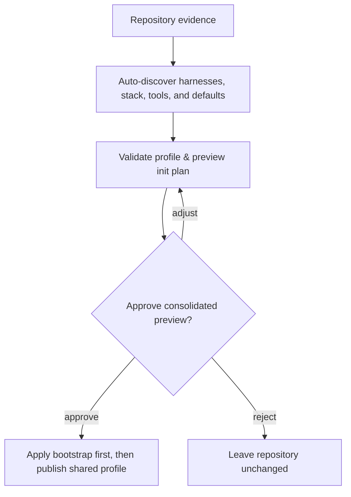

# Getting Started with Forgix

This guide installs Forgix, creates durable project engineering conventions,
runs a first task, and explains how to resume safely. Normative behavior remains in the
[Lifecycle contract](lifecycle-contract.md) and
[Project Engineering Profile contract](project-profile-contract.md).

## 1. Check requirements

Plugin and CLI users need:

- **Codex**, **Claude Code**, or **Antigravity** (with plugin support);
- Node.js 26 or newer;
- Git; and
- Linux or macOS. Windows is unsupported.

Check the runtime before installation:

```bash
node --version
```

The distributed ESM runtime installs no dependencies and performs no network access by
itself. Bun is not required to use the published plugin. It is a contributor dependency only.

## 2. Install the plugin

Choose your agent harness:

### Codex

```bash
codex plugin marketplace add Acrazie/forgix
codex plugin add forgix@acrazie
```

The same installation is available interactively through `/plugins`: select
**Acrazie**, install **Forgix**, then start a new Codex session.

### Claude Code

```text
/plugin marketplace add Acrazie/forgix
/plugin install forgix@acrazie
```

Or via CLI: `claude plugin marketplace add Acrazie/forgix && claude plugin install forgix@acrazie`.

### Antigravity

```bash
agy plugin install https://github.com/Acrazie/forgix
```

For Antigravity App/for IDEs, open `/plugin` and follow the
[official installation procedure](https://antigravity.google/docs/plugins.md).
Start a new host session after updates; no personal caches or installations need to be deleted.
If you need to install from a local clone instead: `git clone entire://aws-eu-central-1.entire.io/et/forgix/forgix && agy plugin install ./forgix`.

### Deterministic CLI backend

Forgix is agent-first: initialize repositories through your coding agent (`$forgix init`,
`/forgix:forgix init`, or `/forgix init`). Bare `forgix init` in a terminal refuses.
Read-only and deterministic backend commands remain available when needed:

```bash
npx @acrasie/forgix init check [--strict]
npx @acrasie/forgix init sync --plan|--apply [--adopt]
npx @acrasie/forgix status
npx @acrasie/forgix resume <task-id>
npx @acrasie/forgix config validate
```

### Updating from the former subdirectory layout

The root-layout migration keeps `forgix@acrazie` and the existing versions.
In isolated local profiles, Codex CLI 0.163.0 refreshed the installed root with
`codex plugin add forgix@acrazie` after the marketplace source changed.
Start a new session to reload its skills.

Claude Code 2.1.252 treats `claude plugin update forgix@acrazie` as a no-op
when the version remains 2.0.0. If you deliberately want to replace that existing
installation after your marketplace contains the root-layout revision, use its
native reinstall commands yourself, then start a new session:

```bash
claude plugin marketplace update acrazie
claude plugin uninstall forgix@acrazie
claude plugin install forgix@acrazie
```

This sequence was verified against a local marketplace in an isolated profile,
not the remote release. It preserves the public identity and does not manually
clear caches or change project configuration. Forgix does not run it automatically.
New installations need no migration steps. Antigravity CLI 1.5.2 validated and
installed the local root layout with six skills and no plugin rules; its only
validation warning was the ignored contributor `AGENTS.md` at the root.
GitHub URL installation and Antigravity App/for IDEs remain unverified.

## 3. Run Project INIT

Open your repository in Codex (`$forgix init`), Claude Code (`/forgix:forgix init`), or
Antigravity (`/forgix init`) and invoke:

```text
$forgix init
```

Project INIT is the sole repository initialization and drift-reconciliation entry point
(bare `forgix init` in a terminal refuses under the Agent-First Plugin Principle):



It auto-discovers installed harnesses (`.codex/`, `.claude/`, `.agents/`), manifests, quality
scripts (proposing repo-specific `protectedSurfaces` and `surfaceVerificationRules`),
existing ecosystem tools (Entire, Dagger, Fallow, Context7, etc.) for `integrations`, and
defaults on greenfield repositories with zero upfront questions. If the repository is already
in sync with no profile change, it reports "already up to date" with zero prompts and zero writes.

An abbreviated interaction can look like this:

```text
You:      $forgix init
Forgix:   Discovered Node.js/TypeScript repo (codex, claude, antigravity).
          Proposed profile (.forgix/project.yaml) + bootstrap plan (.forgix/config.yaml,
          .forgix/factory/{rules,agents,skills}, harness projections, hooks, .gitignore).
          Approve and apply these changes? (or request adjustments)
You:      Approve
Forgix:   Applied bootstrap and published .forgix/project.yaml.
```

One explicit approval authorizes atomic bootstrap application (`forgix init apply`) followed by
idempotent `.forgix/project.yaml` publication (`forgix project-profile publish`).

### Project INIT outputs

| File                                                               | Content                                                                      | Git policy                      |
| ------------------------------------------------------------------ | ---------------------------------------------------------------------------- | ------------------------------- |
| `.forgix/project.yaml`                                             | Portable shared project identity, optional stack, topology, and conventions. | Review and commit when desired. |
| `.forgix/config.yaml`                                              | Selected `harnesses`, `hooks.enforcement`, `bootstrap`, `factoryPolicies`.   | Review and commit when desired. |
| `.forgix/factory/{rules,agents,skills}` + harness projections      | Canonical Factory as Code sources plus Codex/Claude/Antigravity projections. | Review and commit when desired. |
| `.codex/hooks.json`, `.claude/settings.json`, `.agents/hooks.json` | Non-destructive, fail-open `Harness Lifecycle Hook` entries.                 | Review and commit when desired. |
| `.gitignore`, `.worktreeinclude`                                   | Delimited `# forgix:start ... # forgix:end` hygiene blocks.                  | Review and commit when desired. |
| `.forgix/project.local.yaml`                                       | Absolute service paths and personal non-contractual prefs.                   | Gitignored.                     |
| `.forgix/diagrams/*.mermaid.md`                                    | Optional canonical-profile projection.                                       | Commit with shared profile.     |

Secrets, secret-like values, and absolute machine paths are rejected from the shared
profile. A local preference cannot weaken repository policy or an approved shared
convention. Project INIT creates neither application code nor Forgix task state.

## 4. Run the first task

Invoke a concrete software objective (`$forgix` on Codex, `/forgix:forgix` on Claude Code,
`/forgix` on Antigravity):

```text
$forgix Add rate limiting to the public authentication endpoints
```

The normal task path is:

```text
INTAKE -> SHAPE -> GATE -> BUILD -> ASSURE ✓
```

1. **INTAKE** establishes product objective, observable success, constraints, and risk.
2. **SHAPE** reads repository evidence, resolves technical uncertainty, and prepares a
   Quick or Plan implementation contract.
3. **GATE** displays a compact validation card and requires explicit approval of the
   exact contract.
4. **BUILD** lets the active host agent (Codex, Claude Code, or Antigravity) implement the
   complete approved plan. Forgix only checks the current approval/digest boundary and
   returns material changes to SHAPE.
5. **ASSURE** reviews the result and runs fresh criterion-linked verification.

GATE approval covers local implementation only. It never authorizes commit, push, pull
request, registry publication, or release.

### Optional: Plan and run a GitHub Project roadmap

For multi-feature initiatives, run upstream roadmap ideation first:

```text
$forgix roadmap
$forgix run-issue 42
$forgix run-roadmap --limit 3 --parallel 1
```

`$forgix roadmap` guides a 3-phase ideation session (Divergence -> Convergence -> ASCII `tree`
or Mermaid DAG synthesis), publishes `Feature` parents and atomic `Work Item` sub-issues to
GitHub Project v2 (`gh auth status` with `project` scope required), and sets Wave-1 unblocked
items to `Ready`. `$forgix run-issue` / `$forgix run-roadmap` isolate each `Work Item` in a
fresh `main`-based worktree, reserve a durable task/worktree coordinate, and pause
at human GATE regardless of risk.

## 5. Configuration and harness guardrails

### Managed BUILD installation

1. Run agent-driven init (`$forgix init`, `/forgix:forgix init`, or `/forgix init`) to
   reconcile hooks and automatically pin the installed v2 bundle in your machine-local
   config (`${XDG_CONFIG_HOME:-$HOME/.config}/forgix/cli-path.<harness>`). Antigravity
   also resolves `$HOME/.gemini/config/plugins/forgix/dist/forgix.mjs` automatically.
   You can still override the bundle path explicitly via an absolute `FORGIX_CLI_PATH`
   in the native harness environment when needed; managed hooks never fall back to `PATH`
   or a repository-local build. Reload the harness after hook changes.
2. Before approving GATE or starting or resuming BUILD, run `init check-build <harness>`
   with the skill's installed bundle from the task worktree. Require status
   `native_verification_required` and receipt version 2. Compare the harness, worktree,
   canonical bundle path and SHA-256 with the actual `Forgix native SessionStart:`
   message from that worktree. An exit code alone is not evidence.
3. Inspect effective host registration and exercise the actual pre-write and post
   callbacks in a disposable worktree. Verify both launch that same bundle. Local
   config alone, shell replay, or a fail-open result is not native evidence.
   Recheck after any change to the registration, pin or bundle. If any evidence is
   missing, stale or mismatched, stop before GATE approval or BUILD writes,
   report the diagnostic and restore a compatible installation.
   Suspend BUILD and all Roadmap writes during incompatible migration or rollback,
   including publication, status, checkpoint, and tracker updates. Stop in-flight
   writers and take a consistent local register backup before enabling compatible
   writers. Do not let an old writer replace a register containing reservations.

`$forgix init` (`/forgix:forgix init` on Claude Code, `/forgix init` on Antigravity)
manages both the shared engineering profile (`.forgix/project.yaml`) and repository
configuration (`.forgix/config.yaml`, including selected `harnesses`, `hooks.enforcement`
mode `balanced | strict | warn`, `bootstrap` modules, worktree behavior, subscription/quota
hints for `codex`/`auto`, and allowlisted `integrations`). Under the Agent-First Plugin
Principle, Forgix has no interactive terminal wizard—running bare `forgix init` in a
terminal refuses and points you to your coding agent.

The npm package is named `@acrasie/forgix` and the installed command is named `forgix`; the primary skill is `$forgix`
(Codex), `/forgix:forgix` (Claude Code), or `/forgix` (Antigravity).
Neither `dev-flow` nor `codex-dev-flow` is shipped as a CLI alias.
Existing installations of the old npm package, marketplace source, or `dev-flow` files are
not automatically migrated. Replace or re-add the Acrazie marketplace source as
`Acrazie/forgix`, install `forgix@acrazie`, and replace the old plugin installation rather
than installing both plugin identities side by side. Rename existing CLI configuration files
to `~/.forgix/config.yaml`, `.forgix/config.yaml`, and `.forgix/config.local.yaml` (or
re-run `$forgix init`), regenerate and re-approve shared project profiles with
`$forgix init` (`/forgix:forgix init` or `/forgix init`), and update retained `docs/forgix/`
paths and `<!-- forgix:... -->` domain markers. Local `.forgix/tasks/`, `.forgix/cache/`,
`.forgix/init/`, and `.forgix/roadmap/` store runtime state consistently across harnesses.

Defaults already exist for all operational settings. Inspect, validate, or check bootstrap
drift from your harness (`$forgix`, `/forgix:forgix`, or `/forgix`) or deterministic CLI:

```text
$forgix config show --explain
$forgix config validate --json
npx @acrasie/forgix init check
```

Task validation, atomic persistence, and gate decisions can also be driven deterministically via
the bundled CLI:

```text
npx @acrasie/forgix task validate [task-id]
npx @acrasie/forgix task save <task-id>
npx @acrasie/forgix task gate <task-id> [--view | --approve --digest=<shown-digest> | --reject | --change=<instruction> | --autonomous [--issue=<ref>]]
```

Configuration precedence is:

```text
internal defaults
  < ~/.forgix/config.yaml
  < .forgix/config.yaml
  < .forgix/config.local.yaml
  < invocation flags
  < non-weakenable repository policy
```

## Resume and troubleshoot

### Project INIT was interrupted

Run `$forgix init` again in the same repository. Forgix reads the compact local
session and resumes the exact active question unless its dependency evidence changed.

### Project evidence or harness setup drifted

Run `$forgix sync` (`/forgix:forgix sync` on Claude Code, `/forgix sync` on Antigravity) to
incrementally check and update an already-initialized repository after a plugin upgrade or
configuration drift. `$forgix sync` inspects hooks, `.gitignore`, `.worktreeinclude`,
`.forgix/factory/**` projections, new `bootstrap` capabilities, the active harness CLI pin, and
`.forgix/project.yaml` freshness, then presents one consolidated preview before applying changes
via `forgix init sync --apply` (and `forgix project-profile publish` if the profile changed).
In CI, run `forgix init check --strict` to verify versioned repository files without requiring a
machine-local CLI pin. For uninitialized repositories or full re-onboarding, run `$forgix init`.
Rejected changes leave the shared profile byte-for-byte unchanged.

### Profile validation or approval failed

No shared publication occurs. Review the reported schema, privacy, authority, revision,
or digest error, correct the candidate through Project INIT, validate again, then approve
the new exact digest. Never edit around validation with a direct profile write.

### Shared and local profiles conflict

The shared profile has higher authority. Remove the conflicting local preference, or run
Project INIT to propose a separately validated shared-profile update. Absolute service
paths belong only in the local overlay.

### A task was interrupted

Inspect or resume it from Codex:

```text
$forgix status [task-id]
$forgix resume <task-id>
```

Resume reconciles durable state before continuing. It does not infer approval from a
previously displayed but changed implementation contract.

### Node.js is rejected

Run `node --version` and install Node.js 26 or newer. Node.js 25 and older are outside the
supported runtime contract.

## Existing projects

Use `forgix` (`$forgix` on Codex, `/forgix:forgix` on Claude Code, `/forgix` on Antigravity);
former commands have no aliases. Forgix state, configuration, profiles, diagrams,
and Plan projections live under `.forgix/` and `docs/forgix/` across all three
harnesses without fallback:

1. **CLI configuration**: migrate legacy `~/.codex/*.yaml` and `.codex/*.yaml`
   files to `~/.forgix/config.yaml`, `.forgix/config.yaml`, and
   `.forgix/config.local.yaml`, or re-run `$forgix init` (`/forgix:forgix init` or
   `/forgix init`; legacy filenames are ignored silently).
2. **Project Engineering Profile**: re-run `$forgix init` (`/forgix:forgix init` or
   `/forgix init`) and re-approve rather than hand-renaming signed
   `.codex/*.project.yaml` files (keeping shared profiles at `.forgix/project.yaml` and
   diagrams below `.forgix/diagrams/`), and rename local overrides to
   `.forgix/project.local.yaml`.
3. **Plan projections and domain markers**: move retained `docs/dev-flow/` plan files to
   `docs/forgix/`, and replace or remove legacy `<!-- dev-flow:... -->` markers in domain
   documents so the next projection does not append a second `<!-- forgix:... -->` block.

## Command reference

| Codex                              | Claude Code                               | Antigravity                        | Purpose                                                                                              |
| ---------------------------------- | ----------------------------------------- | ---------------------------------- | ---------------------------------------------------------------------------------------------------- |
| `$forgix <objective>`              | `/forgix:forgix <objective>`              | `/forgix <objective>`              | Start a software change.                                                                             |
| `$forgix init`                     | `/forgix:forgix init`                     | `/forgix init`                     | Discover conventions, configure `.forgix/config.yaml`, and bootstrap/reconcile rules & hooks.        |
| `$forgix sync`                     | `/forgix:forgix sync`                     | `/forgix sync`                     | Check and incrementally update existing Forgix config, hooks, factory projections, pin, and profile. |
| `$forgix roadmap`                  | `/forgix:forgix roadmap`                  | `/forgix roadmap`                  | Ideate and publish a GitHub Project v2 feature roadmap.                                              |
| `$forgix run-issue <#num>`         | `/forgix:forgix run-issue <#num>`         | `/forgix run-issue <#num>`         | Run one ready roadmap Work Item in an isolated worktree.                                             |
| `$forgix run-roadmap [flags]`      | `/forgix:forgix run-roadmap [flags]`      | `/forgix run-roadmap [flags]`      | Execute ready roadmap Work Items (`--limit N`, `--parallel M`).                                      |
| `$forgix resume <task-id>`         | `/forgix:forgix resume <task-id>`         | `/forgix resume <task-id>`         | Resume an interrupted task.                                                                          |
| `$forgix status [task-id]`         | `/forgix:forgix status [task-id]`         | `/forgix status [task-id]`         | Inspect task status.                                                                                 |
| `$forgix config show [--explain]`  | `/forgix:forgix config show [--explain]`  | `/forgix config show [--explain]`  | Show effective configuration and optional provenance.                                                |
| `$forgix config validate [--json]` | `/forgix:forgix config validate [--json]` | `/forgix config validate [--json]` | Validate effective configuration.                                                                    |

Deterministic CLI backend (invoked by agents and hooks; bare `forgix init` refuses):
`npx @acrasie/forgix init check`, `npx @acrasie/forgix status`,
`npx @acrasie/forgix resume <task-id>`, `npx @acrasie/forgix task validate [task-id]`,
`npx @acrasie/forgix task save <task-id>`,
`npx @acrasie/forgix task gate <task-id> [--view | --approve --digest=<shown-digest> | --reject | --change=<instruction> | --autonomous [--issue=<ref>]]`,
and `npx @acrasie/forgix config validate`. Durable task state is stored under `.forgix/tasks/<task-id>.json`.

`quick`, `standard`, and `critical` at objective start are plain objective text, not
modes or aliases. Quick or Plan is selected only after Discovery. Risk and policy—not
that preparation profile—control safety safeguards.

### Harness routing and scope

On **Codex**, Forgix captures quota/model telemetry once via `codex app-server`
(`mode: "codex-app-server"`). On **Claude Code** and **Antigravity**, Forgix uses
host-native routing (`mode: "host-native"`, `model: null`, `effort: null`), skipping
`codex app-server` and quota caches so the host harness executes each stage directly.

Use Forgix when a change needs product or technical decisions, implementation, or
proof. Plain questions, read-only exploration, and Git/GitHub delivery do not need a Forgix task.

## Next references

- [Plugin README](../README.md)
- [Lifecycle contract](lifecycle-contract.md)
- [Project Engineering Profile contract](project-profile-contract.md)
- [Configuration schema](../schemas/config.schema.json)
- [Project profile schema](../schemas/project-profile.schema.json)
- [Glossary](glossary/forgix.md)
