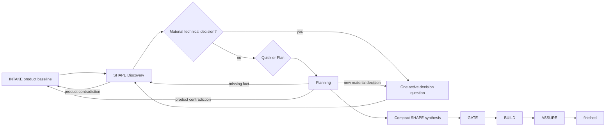

# Target INTAKE, SHAPE, and Project INIT Contract

## Contract status

This document records accepted complete target. Agentic Project INIT and Project
Engineering Profile transaction from ADR 0027 are implemented and governed by
[profile contract](project-profile-contract.md). INTAKE and ordinary SHAPE integration
from ADR 0026 remain pending and non-normative. Until that increment updates schema,
state machine, skills, projections, and tests atomically,
[current lifecycle contract](lifecycle-contract.md) remains authoritative for tasks.

The remaining target extends unreleased TaskState V4. Each delivery increment must
update its runtime, schema, skills, normative contract, and tests together; this document
never becomes a second source of runtime truth.

## Purpose

The target makes three boundaries explicit:

1. INTAKE obtains stable product decisions without forcing a fixed questionnaire.
2. SHAPE discovers facts and interviews every material technical decision in dependency
   order, one question at a time.
3. `$dev-flow init` discovers and validates durable project engineering conventions so
   later tasks do not repeat them.

The design does not add product implementation to INIT, duplicate final confirmation in
SHAPE, move Git or GitHub operations into task state, or replace the deterministic
`npx codex-dev-flow init` plugin-configuration wizard.

## Target lifecycle

```text
INTAKE: product baseline
   |
   v
SHAPE: Discovery <-> technical decision interview -> Quick|Plan -> Planning
   |                                                        |
   +---- targeted product contradiction -> INTAKE ----------+
   |
   v
GATE: deterministic preflight + one final approval
   |
   v
BUILD -> ASSURE -> finished
```



## INTAKE contract

### Product baseline

INTAKE resolves five mandatory dimensions, not five mandatory prompts:

1. objective;
2. affected users and product value;
3. scope and boundaries;
4. observable success and its validator; and
5. product risks and determining constraints.

Explicit request content fills dimensions directly. INTAKE asks only for missing or
contradictory product decisions, one question at a time. Each question contains two or
three viable choices, one justified recommendation, and free-form input. One answer may
close several dimensions when its meaning is explicit.

Product-visible behavior and UX belong to INTAKE. Repository facts, implementation
architecture, data mechanics, and other technical choices belong to SHAPE.

### Stability and targeted reopening

The completed Product Baseline is stable. SHAPE does not reinterpret or mutate it.
Fresh technical evidence routes a contradiction by cause:

| Cause                                                                     | Owner            | Result                                             |
| ------------------------------------------------------------------------- | ---------------- | -------------------------------------------------- |
| Discovery evidence is stale or incomplete                                 | Discovery        | Refresh affected evidence.                         |
| Selected technical option conflicts, but another compatible option exists | SHAPE            | Invalidate technical decision and dependents.      |
| Evidence proves infeasibility or materially changes product outcome       | INTAKE           | Reopen affected product decision and dependents.   |
| Repository or system policy conflicts                                     | Higher authority | Reject lower decision or require compliant option. |

Only transitive dependency closure is invalidated. Unrelated product decisions,
evidence, and contract sections remain current.

INTAKE adds a dedicated confirmation only when runtime materially interpreted or
normalized free-form input, or resolved a contradiction. Otherwise explicit request and
answers suffice. GATE remains sole final contract approval.

## SHAPE contract

### Facts before questions

SHAPE explores available environment before asking for facts. Discovery may inspect
repository guidance, profiles, manifests, lockfiles, configuration, tests, contracts,
representative code, safe command results, configured service roots, and official
primary documentation when local sources cannot resolve a version-sensitive fact.

Evidence records source, version or fingerprint, observation time, and freshness rule.
Unverifiable user information has `user_asserted` provenance and never silently becomes
verified technical proof.

Discovery and interview interleave. Runtime explores only enough of a branch to decide
whether it remains viable or creates a material decision. Safe, reversible experiments
may run in temporary task space. Product writes, dependency installation, migrations,
and external side effects remain forbidden before GATE.

### Material technical decisions

A decision is material when alternatives can materially change architecture,
framework/runtime or a major dependency, schema or migration, cross-service contract,
security or privacy, compatibility, concurrency, performance, cost, operations,
rollback, or an approved profile convention. Semantic classification may add another
decision only with a persisted impact reason.

Repository-conforming and reversible details remain agent-owned. Material choices
remain user-owned. “Choose for me” cannot close a material decision; explicit acceptance
of recommended option can.

When more than three feasible options exist, SHAPE presents two or three viable,
non-dominated choices. Excluded choices remain available on request, and free-form input
remains valid. If evidence cannot distinguish a winner, recommendation carries explicit
low confidence and the irreducible trade-off.

### Dependency-directed interview

`DecisionGraph` is acyclic. Runtime asks highest-impact unblocked root first, then its
dependents. Exactly one `ShapeDecisionQuestion` is active and visible. It contains:

- stable decision and parent keys;
- concise parent context and direct consequences;
- fresh evidence and provenance;
- recommended option, reason, and confidence;
- two or three viable options; and
- free-form answer capability.

Full graph remains internal unless user requests it. One answer may explicitly close
several branches. Revisions invalidate only affected descendants, evidence, and
contract sections. Long interviews persist normalized decisions and exact active
question—not transcript or hidden reasoning.

No hard question cap exists. No periodic checkpoint asks permission merely because five
questions passed, and no cost estimate blocks progress. State saves after each answer.
Runtime warns only when a real context or quota boundary threatens resume.

### Visual decision evidence

Runtime uses cheapest representation capable of resolving decision:

1. ASCII for simple flows, trees, or rough wireframes;
2. Mermaid for non-trivial architecture, state, sequence, or dependency views;
3. isolated HTML/CSS for material UI layout or interaction choices; and
4. Excalidraw or generated images only when requested or necessary.

Two or three variants may appear in one question when visual comparison is itself the
decision. Temporary prototypes never enter product source before GATE. Persisted
Mermaid is generated projection, never canonical architecture authority.

### Preparation and completion

Quick/Plan choice occurs after main material technical decisions and before Planning.
Planning can still emit targeted Discovery Targets or Technical Decisions when a new
dependency appears.

SHAPE completes only when semantic and deterministic checks agree:

- no material uncertainty remains;
- decision graph is valid and has no open required branch;
- evidence and applicable profile are current;
- acceptance criteria cover product success;
- tasks and validations cover every criterion; and
- risks, compatibility, migration, operations, and rollback are resolved when
  applicable.

User request cannot force an unresolved mandatory branch closed. Completion renders one
compact decision, architecture, exception, risk, and validation synthesis. Existing
five-line GATE card follows in same interaction; SHAPE asks no duplicate final approval.

## Target state extension

### Statuses and resume

Current `awaiting_profile_choice` remains dedicated to Quick/Plan. Target adds
`awaiting_shape_decision`:

```text
discovering|planning -> awaiting_shape_decision -> discovering|planning
discovering -> awaiting_profile_choice -> planning
planning -> discovering
planning|discovering -> awaiting_intake_decision -> discovering|planning
planning -> awaiting_approval
```

`awaiting_shape_decision` stores exact active question and exact prior SHAPE role.
Resume re-renders same question unless a dependency fingerprint changed; then runtime
invalidates it and returns to targeted Discovery.

### Conceptual model

| Record                      | Owns                                                                                          |
| --------------------------- | --------------------------------------------------------------------------------------------- |
| `ProductBaseline`           | Five product dimensions, provenance, completeness, targeted invalidations.                    |
| `TechnicalDecision`         | Stable key, materiality reason, options, selected option, dependencies, provenance, revision. |
| `ShapeDecisionQuestion`     | Exact active user question, evidence, recommendation, confidence, options, parent context.    |
| `DecisionGraph`             | Acyclic product, technical, evidence, profile, and contract dependencies.                     |
| `UserAssertion`             | Unverified statement, scope, source actor, timestamp, and affected decisions.                 |
| `ProjectEngineeringProfile` | Durable shared project architecture and conventions.                                          |
| `LocalProfileOverlay`       | Non-contractual local preferences and service-path mapping.                                   |
| `ProfileApprovalReceipt`    | User approval bound to exact shared-profile content digest.                                   |
| `VisualProjection`          | Generated Mermaid or temporary visual reference derived from canonical records.               |

TaskState remains V4 because target work extends an unreleased schema. Schema and
runtime must reject partial records and impossible status/role combinations.

## Agentic project INIT

### Separate interface

`$dev-flow init` performs model-assisted project Discovery and interview. Existing
`npx codex-dev-flow init` remains deterministic plugin configuration. Neither command
aliases the other.

INIT core covers stack, structure, boundaries, dependency direction, naming, errors,
tests, and quality. It activates frontend, API, data, security, concurrency,
performance, compatibility, migration, observability, deployment, rollback, or
operations modules only when evidence or user input makes them applicable. Greenfield
INIT creates profile and optional diagrams only, never application scaffold.

### Profile files and authority

Shared canonical file:

```text
.codex/dev-flow.project.yaml
```

Local gitignored overlay:

```text
.codex/dev-flow.project.local.yaml
```

Authority order is:

```text
system instructions and repository policy
-> INTAKE product decisions
-> explicit task exception
-> shared engineering profile
-> non-contractual local preferences
-> agent defaults
```

Shared profile stores durable architecture and conventions only. ShapeState stores
volatile observations and task evidence. Local overlay cannot weaken higher authority.
No profile is required to run ordinary task; SHAPE can discover task-relevant
conventions and offer durable findings once before GATE.

### Multi-service topology

Each repository owns its profile. Root profile stores logical topology, responsibilities,
dependencies, contracts, and profile references. Local overlay maps logical service IDs
to absolute paths. Shared files never contain absolute local paths.

Discovery is progressive: inspect cheap topology, guidance, manifests, and contracts
across accessible service roots; read implementation deeply only when active decision
requires it. An external repository profile needs its own validation and atomic write.

### Drift reconciliation and transaction

INIT and SHAPE compare profile fingerprints with fresh evidence. Facts are rediscovered;
user-owned conventions are re-interviewed. Only affected closure becomes stale.

Profile changes accumulate in isolated proposed model. Final validation shows adaptive
summary and offers exact canonical YAML through `view`. Approval creates
`ProfileApprovalReceipt` containing actor, timestamp, profile identity, revision, and
exact content digest. Receipt stays outside digest to prevent cycle. Profile and
generated projections publish atomically.

Rejected update leaves shared profile byte-for-byte unchanged and writes no shared
stale marker. Explicit task-local exception may continue when policy permits; mismatch
remains local and drift is rediscovered later.

Profile validation is separate from task GATE because profile affects future tasks.

## Implementation increments

Target lands through three independently reviewable pull requests:

1. completed: target contract, ADRs, glossary, and conceptual model;
2. completed: `$dev-flow init`, shared/local profile schemas, reconciliation,
   digest/receipt, and multi-service privacy boundaries; and
3. `awaiting_shape_decision`, decision graph, adaptive visuals, INTAKE reopening, and
   SHAPE/GATE integration.

Runtime increment must update state schema, lifecycle state machine, capsule/projection
types, skills, lifecycle contract, glossary status labels, metrics allowlist where
needed, distribution artifacts, and automated tests together.

## Target acceptance criteria

- Explicit product input satisfies INTAKE dimensions without redundant questions.
- Missing product decisions are asked one at a time and become stable.
- Repository facts are discovered rather than asked.
- Every open material technical decision has exactly one user-owned resolution path.
- Decision order follows acyclic dependencies and selective invalidation.
- Resume restores exact technical question and prior SHAPE role.
- No question cap, periodic progress gate, or cost-estimation prompt blocks SHAPE.
- Product contradiction reopens only affected INTAKE decision.
- Profile writes require separate digest-bound approval and are atomic.
- Shared profile contains no absolute local path or volatile task evidence.
- Multi-repository writes respect repository ownership.
- SHAPE synthesis and existing GATE card form one interaction with one final approval.
- Current normative runtime behavior remains unchanged until full target increment lands.

## Decision records

- [ADR 0026](adr/0026-keep-intake-product-stable-and-interview-shape-by-dependency.md)
- [ADR 0027](adr/0027-add-agentic-project-init-and-versioned-engineering-profiles.md)
