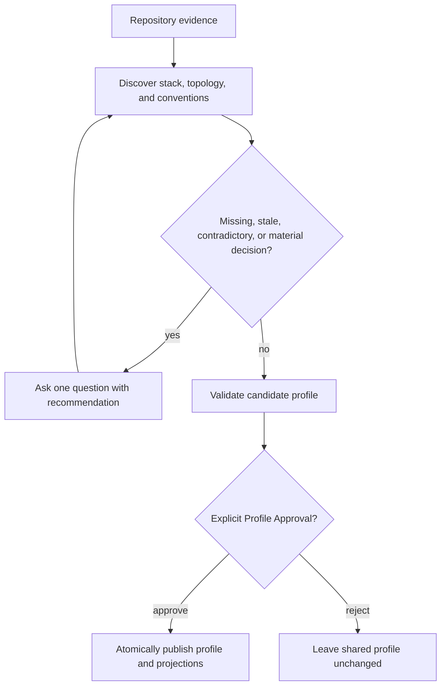

# Getting Started with Forgix

This guide installs Forgix, creates durable project engineering conventions,
runs a first task, and explains how to resume safely. Normative behavior remains in the
[Lifecycle contract](lifecycle-contract.md) and
[Project Engineering Profile contract](project-profile-contract.md).

## 1. Check requirements

Plugin and CLI users need:

- **Codex**, **Claude Code**, or **Antigravity** (with plugin support);
- Node.js 24 or newer;
- Git; and
- Linux or macOS.

Check the runtime before installation:

```bash
node --version
```

Bun is not required to use the published plugin. It is a contributor dependency only.

## 2. Install the plugin

Choose your agent harness:

### Codex

```bash
codex plugin marketplace add Acrazie/codex-dev-flow
codex plugin add forgix@acrazie
```

The same installation is available interactively through `/plugins`: select
**Acrazie**, install **Forgix**, then start a new Codex session.

### Claude Code

```text
/plugin marketplace add Acrazie/codex-dev-flow
/plugin install forgix@acrazie
```

Or via CLI: `claude plugin marketplace add Acrazie/codex-dev-flow && claude plugin install forgix@acrazie`.

### Antigravity

```bash
git clone https://github.com/Acrazie/codex-dev-flow.git
agy plugin install ./codex-dev-flow/plugins/forgix
```

You can also import an existing Claude Code installation (`agy plugin import claude`) or
copy `./codex-dev-flow/plugins/forgix/` into `~/.gemini/config/plugins/forgix/`.

## 3. Run Project INIT

Open your repository in Codex (`$forgix init`), Claude Code (`/forgix:forgix init`), or
Antigravity (`/forgix init`) and invoke:

```text
$forgix init
```

Project INIT is an agentic repository discovery and interview workflow:



It inspects available guidance, manifests, configuration, architecture sources, tests,
contracts, and representative code before asking. Questions cover only unresolved or
material decisions and appear one at a time. There is no fixed question count.

An abbreviated interaction can look like this:

```text
You:      $forgix init
Forgix: Discovery found a Node.js API with HTTP handlers and no explicit error envelope.
          Recommended: one stable JSON error shape at the transport boundary.
          A. Stable JSON envelope (Recommended)
          B. Handler-specific payloads
You:      A
Forgix: Profile candidate validated. Review summary ...
          Approve publication of this exact profile digest?
You:      Approve
```

The wording and decisions adapt to repository evidence. The final explicit approval—not
the sample answer—authorizes profile publication.

### Project INIT outputs

| File                                    | Content                                                     | Git policy                      |
| --------------------------------------- | ----------------------------------------------------------- | ------------------------------- |
| `.codex/dev-flow.project.yaml`          | Portable shared architecture, topology, stack, and rules.   | Review and commit when desired. |
| `.codex/dev-flow.project.local.yaml`    | Absolute service paths and personal non-contractual prefs.  | Gitignored.                     |
| `.codex/project-init/state.yaml`        | Compact resumable interview state; no transcript/reasoning. | Gitignored and temporary.       |
| `.codex/dev-flow/diagrams/*.mermaid.md` | Optional canonical-profile projection.                      | Commit with shared profile.     |

Secrets, secret-like values, and absolute machine paths are rejected from the shared
profile. A local preference cannot weaken repository policy or an approved shared
convention. Project INIT creates neither application code nor Forgix task state.

## 4. Run the first task

Invoke a concrete software objective (`$forgix` on Codex, `/forgix:forgix` on Claude Code,
`/forgix` on Antigravity):

```text
$forgix Add rate limiting to the public authentication endpoints
```

The normal task path is:

```text
INTAKE -> SHAPE -> GATE -> BUILD -> ASSURE ✓
```

1. **INTAKE** establishes product objective, observable success, constraints, and risk.
2. **SHAPE** reads repository evidence, resolves technical uncertainty, and prepares a
   Quick or Plan implementation contract.
3. **GATE** displays a compact validation card and requires explicit approval of the
   exact contract.
4. **BUILD** lets the active host agent (Codex, Claude Code, or Antigravity) implement the
   complete approved plan. Forgix only checks the current approval/digest boundary and
   returns material changes to SHAPE.
5. **ASSURE** reviews the result and runs fresh criterion-linked verification.

GATE approval covers local implementation only. It never authorizes commit, push, pull
request, registry publication, or release.

### Optional: Plan and run a GitHub Project roadmap

For multi-feature initiatives, run upstream roadmap ideation first:

```text
$forgix roadmap
$forgix run-issue 42
$forgix run-roadmap --limit 3 --parallel 1
```

`$forgix roadmap` guides a 3-phase ideation session (Divergence -> Convergence -> ASCII `tree`
or Mermaid DAG synthesis), publishes `Feature` parents and atomic `Work Item` sub-issues to
GitHub Project v2 (`gh auth status` with `project` scope required), and sets Wave-1 unblocked
items to `Ready`. `$forgix run-issue` / `$forgix run-roadmap` isolate each `Work Item` in a
fresh `main`-based worktree, apply autonomous `low`/`medium` Gate receipts when eligible (or
pause `high`/`critical` items for human approval), and hand off Draft PRs on `ASSURE ✓`.

## 5. Optional Configuration wizard

Project INIT owns project engineering knowledge. The separate deterministic
Configuration wizard owns plugin operating preferences (including target `harness`,
worktree behavior, subscription/quota hints for `codex`/`auto`, and allowlisted integrations):

```bash
npx @acrasie/forgix init
```

The npm package is named `@acrasie/forgix` and the installed command is named `forgix`; the primary skill is `$forgix`
(Codex), `/forgix:forgix` (Claude Code), or `/forgix` (Antigravity).
Neither `dev-flow` nor `codex-dev-flow` is shipped as a CLI alias.
Existing installations of the old npm package are not automatically migrated.
Upgrade the Acrazie marketplace and install `forgix@acrazie` to use the renamed
plugin; existing `.codex/` project configuration and state remain unchanged.
Replace the old plugin installation rather than installing both plugin identities
side by side.

Use it to customize target harness, worktree behavior, subscription/quota hints, or allowlisted
integrations. Defaults already exist, so the wizard is optional. Inspect or validate the
resolved configuration from your harness (`$forgix`, `/forgix:forgix`, or `/forgix`) or CLI:

```text
$forgix config show --explain
$forgix config validate --json
```

Configuration precedence is:

```text
internal defaults
  < ~/.codex/dev-flow.yaml
  < .codex/dev-flow.yaml
  < .codex/dev-flow.local.yaml
  < invocation flags
  < non-weakenable repository policy
```

## Resume and troubleshoot

### Project INIT was interrupted

Run `$forgix init` again in the same repository. Forgix reads the compact local
session and resumes the exact active question unless its dependency evidence changed.

### Project evidence changed

Run `$forgix init` again. Fingerprints identify stale decisions and reconcile only
their dependent closure. Repository facts are rediscovered; user-owned conventions are
re-interviewed. Rejected changes leave the shared profile byte-for-byte unchanged.

### Profile validation or approval failed

No shared publication occurs. Review the reported schema, privacy, authority, revision,
or digest error, correct the candidate through Project INIT, validate again, then approve
the new exact digest. Never edit around validation with a direct profile write.

### Shared and local profiles conflict

The shared profile has higher authority. Remove the conflicting local preference, or run
Project INIT to propose a separately validated shared-profile update. Absolute service
paths belong only in the local overlay.

### A task was interrupted

Inspect or resume it from Codex:

```text
$forgix status [task-id]
$forgix resume <task-id>
```

Resume reconciles durable state before continuing. It does not infer approval from a
previously displayed but changed implementation contract.

### Node.js is rejected

Run `node --version` and install Node.js 24 or newer. Node.js 22 and older are outside the
supported runtime contract.

## Next references

- [Plugin README](../README.md)
- [Lifecycle contract](lifecycle-contract.md)
- [Project Engineering Profile contract](project-profile-contract.md)
- [Configuration schema](../schemas/config.schema.json)
- [Project profile schema](../schemas/project-profile.schema.json)
- [Glossary](glossary/forgix.md)
